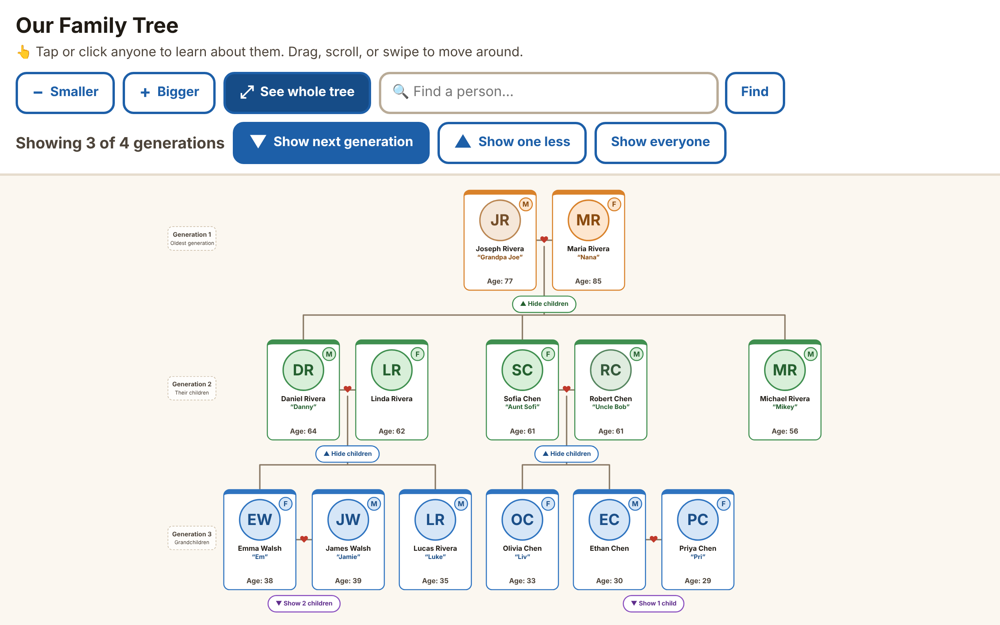

# 🌳 Family Tree: a free, private family tree website

A family tree that's easy for everyone, from 7 to 97: big text, big buttons, tap anyone to see their details.

- **Private:** only people who know your **family password** can look. Strangers, search engines and AI bots see nothing. No accounts needed: family type the password once per device.
- **Only the relatives you approve can make changes**, each with their own passcode.
- Add children, husbands/wives, dates of birth, locations and photos; edit details; merge duplicates; remove people.
- Free to run, and no coding or command line needed to set up.

## Make your own

| | **Online family tree** (recommended) | **Easy kit** |
|---|---|---|
| Who can look | Only people with your family password | Anyone who has the link |
| Who can make changes | Relatives you approve, from any phone or computer | Only you, from your computer |
| Gets new features from this project | One click (**Sync fork**) | Download a new kit |
| Accounts needed | GitHub + Vercel (both free) | Netlify (free) |
| Set-up time | About 20 minutes | About 10 minutes |
| How to start | 👉 **[Step-by-step guide](docs/SETUP-ONLINE.md)** | 👉 **[Download the latest Easy kit](../../releases/latest)**, then open `START-HERE.html` |

## Your family's information stays private

- This repository holds only the **website code** and a **made-up sample family**.
- Your real family (names, dates, photos) is stored in **your own private database**, not on GitHub, and is only sent to people who type your family password.
- Your family password and editor passcodes live only in **your Vercel settings**.
- ⚠️ **Never type real family members or passwords into the files in this repository**, because forks are public. Add people on your website instead.

## Getting updates and sharing improvements

- **Get the newest version:** on your fork's GitHub page, click **Sync fork → Update branch**. Your website updates by itself, and your family data is not touched. ([details](docs/SETUP-ONLINE.md#part-9-get-new-features))
- **Share an improvement:** open a pull request from your fork. ([details](docs/SETUP-ONLINE.md#part-10-share-an-improvement-optional))

## For the maintainer
Publishing, reviewing changes and building the Easy kit: [docs/MAINTAINER.md](docs/MAINTAINER.md).
